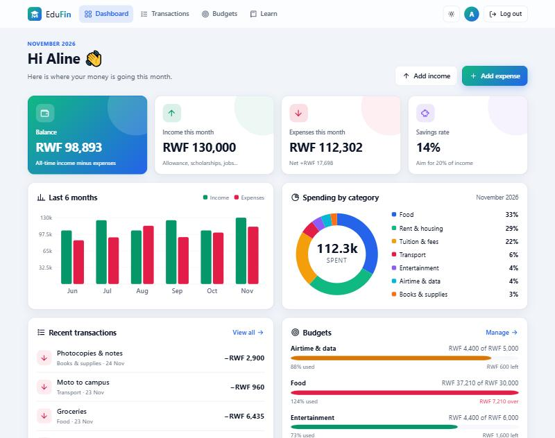
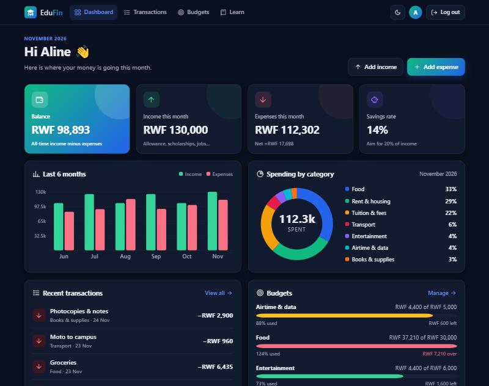
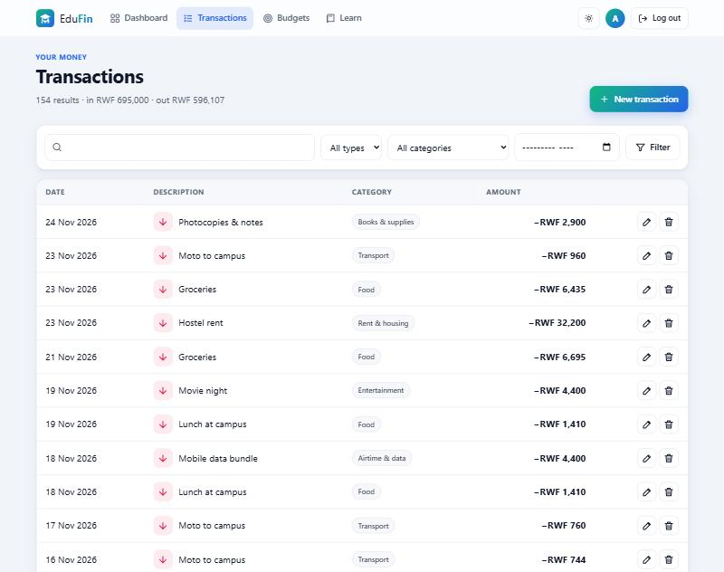
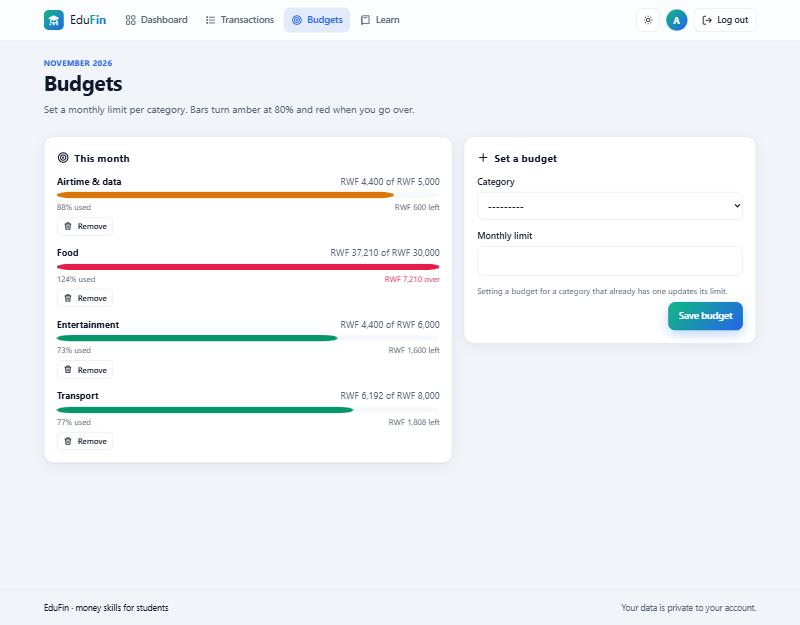
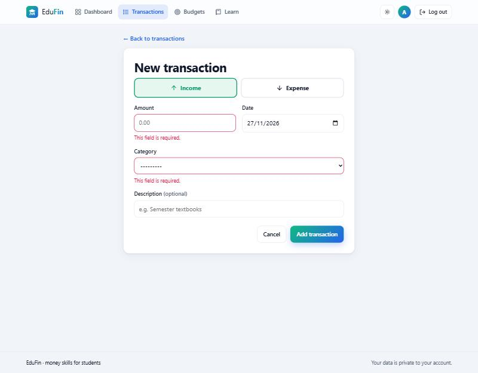
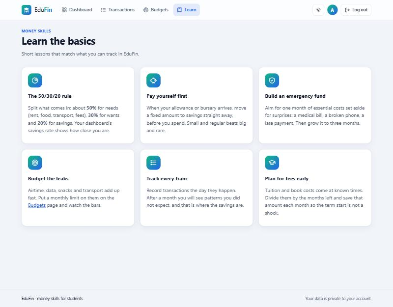
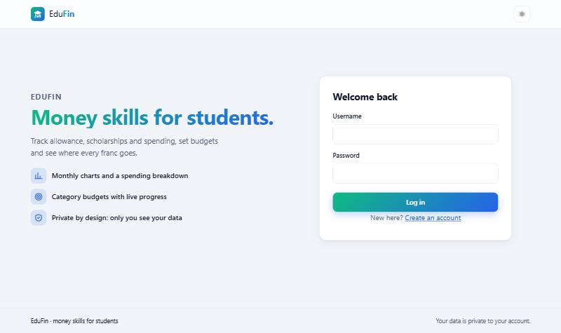
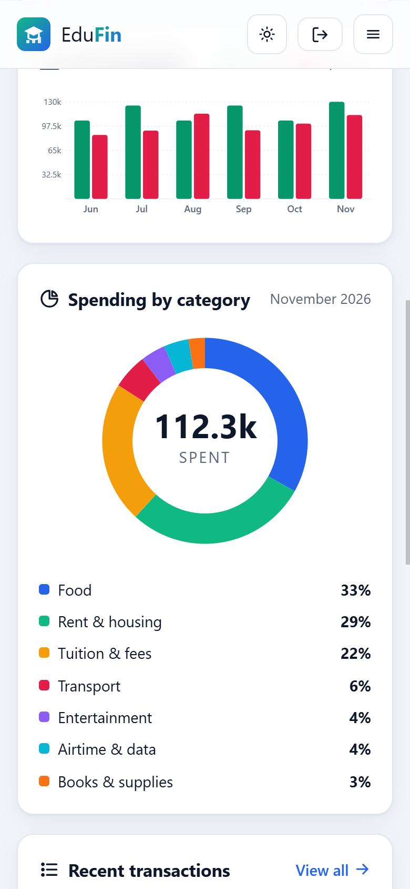

# EduFin: money skills for students

EduFin is a personal finance tracker built for university students. You record income
(allowance, scholarships, part-time work) and expenses (tuition, books, food, rent,
transport, data…), set monthly budgets per category, and see where your money goes on a
dashboard with charts. A short **Learn** section teaches the basics (50/30/20 rule,
emergency funds, planning for fees) and ties each lesson to a feature of the app.

Every user sees **only their own data**, and the app is built secure-by-default: secrets
in environment variables, a strict Content Security Policy, CSRF protection on every form,
hashed passwords with strength rules, login throttling and an audit log.



## Features

- **Dashboard:** balance, this month's income and expenses, and your savings rate as animated
  cards; a 6-month income vs expense bar chart; a spending-by-category donut; recent
  transactions; budget progress; rotating money tips.
- **Transactions:** add, edit and delete income and expenses; search, filter by type,
  category and month; pagination. Categories change to match income or expense.
- **Budgets:** a monthly limit per expense category. Bars turn amber at 80% and red when
  you go over.
- **Learn:** six short lessons on student money skills.
- **REST API** (Django REST Framework): `/api/transactions/` (list/create/update/delete
  your own transactions) and `/api/summary/`.
- **Modern UI:** responsive down to phone size, dark / light mode (remembers your choice and
  follows the system setting), animated SVG icons, charts drawn in plain SVG, reveal-on-scroll
  and count-up effects. All motion is turned off for people who set *reduce motion*.

| Dark mode | Transactions |
|---|---|
|  |  |
| **Budgets** | **Form validation** |
|  |  |
| **Learn** | **Log in** |
|  |  |



## Tech stack

- Python 3.12+ and **Django 6.0** (uses Django's built-in CSP middleware and `LoginRequiredMiddleware`)
- **Django REST Framework** for the JSON API
- SQLite (default; any Django-supported database works)
- Server-rendered templates, one hand-written CSS file and one small vanilla JS file.
  No CSS/JS framework and no CDN, so the CSP can stay `'self'` only.

## Getting started

```bash
git clone https://github.com/Apophiah/EduFinApp.git
cd EduFinApp
python -m venv .venv
# Windows:  .venv\Scripts\activate
# macOS/Linux:  source .venv/bin/activate
pip install -r requirements.txt

cp .env.example .env          # Windows PowerShell: Copy-Item .env.example .env
# generate a secret key and paste it into .env as DJANGO_SECRET_KEY
python -c "from django.core.management.utils import get_random_secret_key as g; print(g())"

python manage.py migrate
python manage.py seed_demo    # optional: demo student with 6 months of data (prints a random password once)
python manage.py runserver
```

Open http://127.0.0.1:8000, sign up (or log in as `demo` with the printed password).
To create an admin account for `/admin/`: `python manage.py createsuperuser`.

### Configuration

All settings come from environment variables (or a local `.env` file, which is git-ignored).
See [`.env.example`](.env.example) for the full list.

| Variable | Default | Purpose |
|---|---|---|
| `DJANGO_SECRET_KEY` | **required** when `DEBUG` is off | Signing key. Never commit it. |
| `DJANGO_DEBUG` | `False` | Turn on only for local development. |
| `DJANGO_ALLOWED_HOSTS` | `localhost,127.0.0.1` in debug | Comma-separated host names. |
| `DJANGO_CSRF_TRUSTED_ORIGINS` | empty | e.g. `https://edufin.example.com` |
| `DJANGO_SECURE_COOKIES`, `DJANGO_SECURE_SSL_REDIRECT`, `DJANGO_HSTS_SECONDS` | on when `DEBUG` is off | HTTPS hardening |
| `DJANGO_BEHIND_PROXY` | `False` | Trust `X-Forwarded-Proto` from your reverse proxy |
| `EDUFIN_CURRENCY` | `RWF` | Currency shown in the UI |

## Running the tests

```bash
python manage.py test
```

There are 45 tests in `accounts/tests.py`, `transaction/tests.py` and `core/tests.py`. They cover:

- **Access control:** every private page redirects to login; the API returns 403 when signed out.
- **Data isolation:** a user cannot list, view, edit or delete another user's transactions or
  budgets (404), in the pages and in the API; the `user` field cannot be injected.
- **Validation:** amounts must be positive and below 100 million; category must match
  income/expense; dates between 2000 and one year ahead; descriptions are trimmed, length-limited
  and reject control characters; HTML is escaped on output.
- **CSRF:** posts without a token are rejected (forms and API), and every POST form has a token.
- **Accounts:** password strength rules, hashed storage, unique email, no role escalation at
  sign-up, POST-only logout, open-redirect protection, login throttling after 5 failures,
  and a read-only audit log in the admin.
- **Headers:** CSP without `unsafe-inline`, `X-Frame-Options: DENY`, `nosniff`, referrer policy,
  and no inline `<script>`/`style=` anywhere in the pages.

### Deployment check

```bash
DJANGO_DEBUG=False DJANGO_SECRET_KEY=<real key> DJANGO_ALLOWED_HOSTS=your.domain \
  python manage.py check --deploy
```

With production settings the only remaining warning is **W021 (`SECURE_HSTS_PRELOAD`)**.
It is left off on purpose: preloading is hard to undo, so you should enable it
(`DJANGO_HSTS_PRELOAD=True`) only once the domain is sure to stay HTTPS-only. With
`DJANGO_DEBUG=True` on your own machine, Django also warns about HTTPS, secure-cookie and
`DEBUG` settings. That is expected in development.

## Security overview

| Area | What EduFin does |
|---|---|
| Secrets | `SECRET_KEY` and `DEBUG` come from the environment; the app refuses to start without a key when `DEBUG` is off. |
| Authentication | Django auth with PBKDF2 password hashing, 4 password validators (min. 10 characters), login required on every private view (middleware + decorators), 8-hour sessions. |
| Brute force | After 5 failed logins in 15 minutes the username is locked for 15 minutes. |
| Authorisation | Every query is filtered by `request.user`; other users' objects return 404. |
| CSRF | `CsrfViewMiddleware` + `` on every form; logout is POST-only; DRF uses session auth with CSRF. |
| XSS | Template auto-escaping and a strict CSP (`script-src 'self'`, `style-src 'self'`, `object-src 'none'`, `frame-ancestors 'none'`). There are no inline scripts or styles. |
| Transport | HTTPS redirect, HSTS, `Secure`/`HttpOnly`/`SameSite=Lax` cookies when `DEBUG` is off. |
| Headers | `X-Frame-Options: DENY`, `X-Content-Type-Options: nosniff`, `Referrer-Policy: same-origin`, `Cross-Origin-Opener-Policy: same-origin`. |
| Audit log | Logins, failed and blocked logins, logouts, sign-ups and every create/update/delete are written to `AuditEvent` (read-only in the admin) and to the `edufin.security` logger. |

## Project structure

```
EduFinApp/        settings (env-driven), root URLs
accounts/         custom User model, sign-up/login/logout, audit log + login throttling
transaction/      Transaction & Budget models, pages, dashboard stats, REST API, seed_demo command
core/             health check and the original Testing API endpoint
templates/        base layout, pages and partials
static/           app.css, app.js, theme.js, logo
docs/screenshots/ README images
```

## API quick reference

All endpoints need a logged-in session; unsafe methods need the CSRF token.

| Method | URL | Description |
|---|---|---|
| GET | `/api/transactions/` | Your transactions |
| POST | `/api/transactions/` | Create (`kind`, `category`, `amount`, `date`, `description`) |
| GET/PUT/PATCH/DELETE | `/api/transactions/<id>/` | One of your transactions |
| GET | `/api/summary/` | Balance, this month's income/expense, savings rate |
| GET | `/health` | Public health check |
